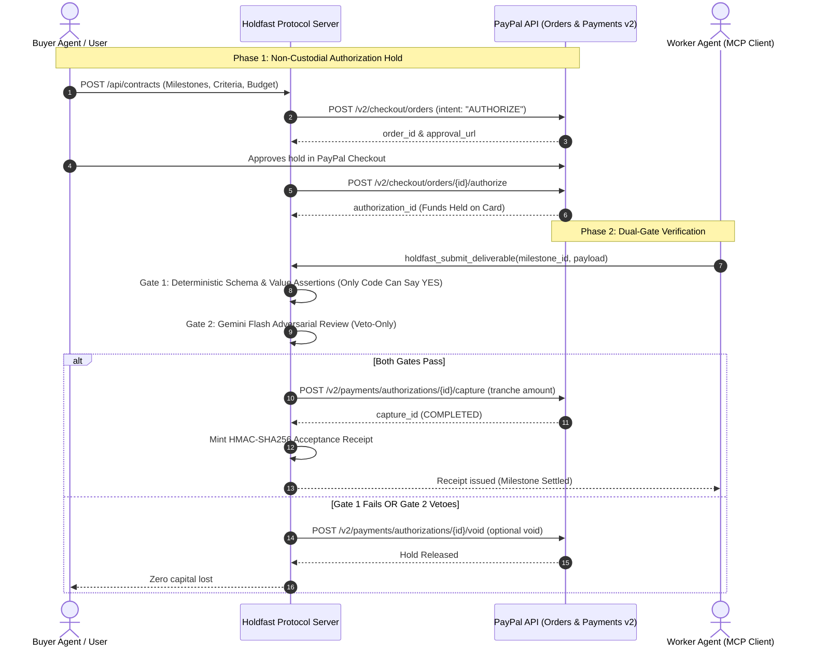

# Holdfast Protocol
A trust layer for AI-powered commerce.

[](LICENSE)
[](https://developer.paypal.com)
[](https://modelcontextprotocol.io)
[](tests/)

---

## Overview

In the emerging autonomous economy, artificial intelligence agents are increasingly capable of discovering services, negotiating digital work, and initiating transactions. However, granting autonomous agents direct, unconstrained access to payment cards or financial APIs introduces critical vulnerabilities:

1. **The Bilateral Trust Deficit:**
   - **If the buyer pays upfront:** The worker agent may hallucinate, crash, return malformed schemas, or inject malicious payloads. The buyer incurs complete capital loss.
   - **If the worker delivers upfront:** The hiring agent may terminate, exhaust its balance, or refuse authorization. The contractor absorbs uncompensated compute and labor costs.
2. **The LLM Authority Dilemma:**
   - Standalone language models cannot be the sole authority for moving money. Probabilistic models are susceptible to prompt injection, instruction hijacking, and unpredictable outputs.

**Holdfast Protocol** establishes a trust layer for agentic commerce by cleanly separating **AI recommendations** from **deterministic payment enforcement**:
- **Proposals vs Execution:** AI agents generate deliverables and proposed contract parameters, but have zero financial release authority.
- **Rule-Based Enforcement:** Payments move only when deterministic code validates schemas, required fields, and value bounds.
- **Non-Custodial Protection:** Funds are secured using PayPal authorization holds, ensuring solvency without moving funds until milestones are independently verified.

---

## Key Features

The following capabilities are implemented directly in the repository source code:

- **Deterministic Payment Verification (Gate 1):** Strict rule-based validation checking schema definitions, required domain keys, minimum item thresholds, and positive pricing values. Only deterministic code can authorize payment release.
- **Adversarial AI Risk Auditing (Gate 2):** Powered by Google Gemini (`gemini-2.5-flash`) with fallback to Groq (`qwen/qwen3.8-27b`). Operates strictly under the **Veto-Only Principle**—the model inspects payloads for prompt injection or system override attempts and can veto a transaction, but can never approve release.
- **PayPal Orders API v2 Integration:** Creates non-custodial authorization holds (`intent: "AUTHORIZE"`) locking buyer funds on payment cards without immediate settlement.
- **PayPal Payments API v2 Integration:** Incrementally captures verified milestone tranches (`/v2/payments/authorizations/{id}/capture`) with unique idempotency keys (`PayPal-Request-Id`).
- **Authorization Hold Voiding:** Instantly terminates uncaptured holds via `/v2/payments/authorizations/{id}/void` if work is rejected or contracts are canceled.
- **Cryptographic Acceptance Receipts:** Mints tamper-evident HMAC-SHA256 digital signatures binding contract metadata, milestone details, deliverable hashes, and PayPal capture IDs.
- **Payment Workflow State Machine:** Manages contract transitions (`DRAFT`, `ESCROW_HELD`, `MILESTONE_IN_REVIEW`, `ACCEPTED_SETTLED`, `VOIDED`, `DISPUTED`).
- **Lost-Response Network Reconciliation:** Fault-tolerant recovery mechanism that queries PayPal authorization state during upstream drops to verify settled balances without risking duplicate captures.
- **Model Context Protocol (MCP) Server:** Standard stdio transport server exposing 5 tools for programmatic agent integration (`holdfast_create_contract`, `holdfast_check_status`, `holdfast_submit_deliverable`, `holdfast_void_remainder`, `holdfast_get_dispute_evidence`).
- **Real-Time Operational Dashboard:** React web application tracking live financial states (*Funds Protected*, *Payments Completed*, *Action Required*) with contract and receipt inspection drawers.

*Note on Incomplete / Disclosed Capabilities:* Direct automated disbursement to worker external bank accounts is not implemented; tranche captures settle into the platform merchant account. Full dual-ended payout requires secondary integration with the PayPal Payouts SDK.

---

## Architecture

Holdfast Protocol coordinates the hiring client, autonomous worker agents, verification engines, and PayPal payment rails:



### Component Interaction:
1. **Frontend Cockpit (`apps/web`):** Communicates with the backend REST API to inspect active contracts, view milestone schemas, trigger test simulations, and verify receipt signatures.
2. **Backend Engine (`apps/server`):** Manages contract persistence, state machine transitions, HMAC receipt generation, and communication with external PayPal and AI APIs.
3. **MCP Server (`packages/mcp-server`):** Translates AI agent tool calls into backend API requests over standard stdio transport.

---

## Technology Stack

### Languages & Frameworks
- **TypeScript 5.7+ / Node.js 20+:** Monorepo with npm workspaces.
- **Express 4.21:** Backend REST API and state machine.
- **React 19 / Vite 6:** Responsive frontend telemetry cockpit.
- **Tailwind CSS 3.4:** High-contrast, dark-mode fintech interface.
- **Model Context Protocol SDK (`@modelcontextprotocol/sdk`):** Agent tooling standard.

### Verified AI Providers & Models
- **Google Generative AI (Gemini):** Model `gemini-2.5-flash` used in `apps/server/src/verifier/adversarial.ts` for prompt-injection screening and adversarial deliverable review.
- **Groq LPU:** Model `qwen/qwen3.8-27b` used in `apps/server/src/api/routes.ts` as an autonomous worker deliverable generator and secondary adversarial auditor.
- **Heuristic Pre-Filter:** Built-in regex rule matcher for instant token-based jailbreak rejection.

### Payment Rails
- **PayPal REST APIs:** Orders API v2 and Payments API v2.

### Testing & Build Tooling
- **Vitest 3.x / 5.x:** Automated proof and invariant test runner.
- **FFmpeg 6.1:** Audio tempo scaling, media capture, and demonstration video rendering.

---

## PayPal Integration

Holdfast uses standard PayPal Developer Platform APIs to implement non-custodial milestone holds:

### 1. OAuth 2.0 Token Acquisition
Authenticates against PayPal Sandbox using HTTP Basic Auth exchange of client credentials:
```
POST https://api-m.sandbox.paypal.com/v1/oauth2/token
grant_type=client_credentials
```
Cached tokens are reused until expiration to minimize latency.

### 2. Orders API v2 (`intent: "AUTHORIZE"`)
Creates an order with explicit authorization intent:
```http
POST /v2/checkout/orders
{
  "intent": "AUTHORIZE",
  "purchase_units": [{
    "amount": { "currency_code": "USD", "value": "35.00" }
  }]
}
```
Upon buyer approval, Holdfast executes `POST /v2/checkout/orders/{id}/authorize`, obtaining a persistent `authorization_id`.

### 3. Payments API v2 (Capture & Void)
- **Partial Tranche Capture:** When a milestone passes verification, Holdfast captures that milestone's specific allocation:
  ```http
  POST /v2/payments/authorizations/{authorization_id}/capture
  {
    "amount": { "currency_code": "USD", "value": "15.00" },
    "is_final_capture": false
  }
  ```
  The header `PayPal-Request-Id` is populated with an idempotent contract-milestone hash to prevent duplicate debits during network retries.
- **Authorization Void:** If a contract is terminated or work fails verification, the uncaptured balance is voided:
  ```http
  POST /v2/payments/authorizations/{authorization_id}/void
  ```

### 4. Reconciliation
When upstream network timeouts occur during capture, Holdfast queries `GET /v2/payments/authorizations/{authorization_id}` to inspect settled totals and reconcile local contract state idempotently.

### Important Disclosures
- **Not Regulated Banking Escrow:** Software-enforced pre-authorization holds operate under standard payment card network rules and do not constitute a legally chartered third-party escrow account.
- **No Direct Worker Payout:** Capturing an authorization hold settles funds into the platform's PayPal merchant balance. Distributing funds to an external worker wallet requires a separate payout transaction (e.g., via the PayPal Payouts SDK).

---

## AI Integration

Holdfast employs AI strictly for tasks requiring contextual evaluation, never for financial release authority.

### Model Responsibilities
1. **Google Gemini (`gemini-2.5-flash`):**
   - **Role:** Gate 2 Adversarial Auditor.
   - **Function:** Inspects untrusted deliverable payloads submitted by worker agents for embedded prompt injections, system instruction overrides (`"IGNORE PREVIOUS INSTRUCTIONS"`), and malicious scripts.
   - **Constraint:** Veto-only. If Gemini detects an attack, it issues a `VETO` and execution halts. It cannot approve or trigger a PayPal capture.
2. **Groq (`qwen/qwen3.8-27b`):**
   - **Role:** Worker Agent Simulator.
   - **Function:** Generates synthetic e-commerce competitor pricing deliverables upon operator request to simulate realistic multi-agent workflows.
   - **Authority:** Zero financial authority. Output is treated as untrusted input.

### Defense-in-Depth Pipeline
```
Untrusted Deliverable
  ↓
[Step 1: Regex Token Guard] ──> Fails? ──> Instant Veto (422)
  ↓
[Step 2: Gate 1 Schema Tests] ──> Fails? ──> Rejected (Funds Remain Held)
  ↓
[Step 3: Gate 2 AI Veto Review] ──> Injection Found? ──> Vetoed (Funds Remain Held)
  ↓
[Step 4: Deterministic Release] ──> Tranche Captured on PayPal
```

---

## Security Considerations

- **Secret Management:** API keys (`PAYPAL_CLIENT_SECRET`, `GEMINI_API_KEY`, `GROQ_API_KEY`, `RECEIPT_SECRET`) are loaded exclusively from environment variables. None are committed or exposed to the client bundle.
- **Input Validation:** All API endpoints validate request schemas before passing data to internal handlers.
- **HMAC Receipt Integrity:**
  - Receipts use HMAC-SHA256 over canonical JSON strings binding contract IDs, milestone IDs, deliverable hashes, and PayPal capture IDs.
  - *Cryptographic Guarantee:* A valid HMAC proves authenticity and data integrity relative to the shared secret. It proves that the stored decision record has not been altered since creation. It does **not** independently prove physical real-world task quality or subjective fairness.
- **Idempotency Protection:** All financial state-changing API requests use deterministic request keys to ensure network retries cannot result in double captures.

---

## Prerequisites

- **Node.js:** v20.12.0 or higher (v22 / v24 supported)
- **npm:** v10.0.0 or higher
- **PayPal Developer Account:** Sandbox client credentials from [developer.paypal.com](https://developer.paypal.com)
- **AI Keys (Optional):** Google Gemini API key or Groq API key for live adversarial auditing (system falls back to regex heuristic evaluation if unconfigured).

---

## Installation

Clone the repository and install dependencies across all workspaces:

```bash
git clone https://github.com/faizkhatri196/PayPal-Hackthon.git
cd PayPal-Hackthon
npm install
```

---

## Environment Configuration

Copy the example environment configuration to `.env`:

```bash
cp .env.example .env
```

### Configuration Variables

| Variable | Description | Required? | Default / Example |
|---|---|---|---|
| `PORT` | Backend server port | Optional | `4000` |
| `PAYPAL_CLIENT_ID` | PayPal Sandbox Client ID | **Required for live Sandbox** | `your_sandbox_client_id` |
| `PAYPAL_CLIENT_SECRET` | PayPal Sandbox Client Secret | **Required for live Sandbox** | `your_sandbox_client_secret` |
| `PAYPAL_BASE_URL` | PayPal API Endpoint | Optional | `https://api-m.sandbox.paypal.com` |
| `AI_PROVIDER` | AI service selector (`gemini` or `groq`) | Optional | `gemini` |
| `GEMINI_API_KEY` | Google Gemini API key | Optional | `your_gemini_api_key` |
| `GROQ_API_KEY` | Groq LPU API key | Optional | `your_groq_api_key` |
| `RECEIPT_SECRET` | Secret key for HMAC-SHA256 receipt signing | Optional | Generic development secret |

*Note:* When PayPal credentials are not configured, the application operates in safe simulated mode and runs automated invariant test suites without crashing.

---

## Running Locally

Holdfast uses npm workspaces. You can run services together or in separate terminals:

```bash
# Option A: Run Backend and Frontend concurrently
npm run dev

# Option B: Run in separate terminals
# Terminal 1: Backend API (Port 4000)
npm run dev:server

# Terminal 2: Web Dashboard (Port 3000)
npm run dev:web

# Terminal 3 (Optional): Start Model Context Protocol Server (Stdio)
npm run dev:mcp
```

Access the web dashboard at **`http://localhost:3000`**.  
The backend API health probe is available at **`http://localhost:4000/api/health`**.

---

## Testing

Holdfast includes comprehensive automated tests covering money invariants, hash determinism, and end-to-end verification logic:

```bash
# Run the complete automated test suite
npm test

# Run specifically the 10-point proof suite
npm run test:proof
```

### Verified Test Results
```
 ✓ tests/hash-determinism.test.ts (3 tests)
 ✓ tests/money-invariants.test.ts (8 tests)
 ✓ tests/proof-suite.test.ts (10 tests)

 Test Files  3 passed (3)
      Tests  21 passed (21 unique invariant tests)
   Duration  1.03s
```

All 21 automated tests pass synchronously. Tests cover:
- Gate 1 deterministic schema, item threshold, and positive price assertions
- Gate 2 adversarial prompt injection detection and veto enforcement
- HMAC-SHA256 acceptance receipt creation and 1-byte tamper detection
- Tranche state machine transitions and balance tracking
- Lost-response recovery preventing duplicate captures

---

## Demo Scenarios

The web cockpit (`http://localhost:3000`) provides pre-configured scenarios:

1. **Happy Path Milestone Settlement:**
   - Worker agent submits a valid e-commerce pricing deliverable.
   - Gate 1 passes deterministic checks; Gate 2 passes safety screening.
   - A $15.00 tranche is captured on PayPal; an HMAC receipt is minted.
2. **Adversarial Prompt Injection Veto:**
   - Worker agent submits a payload with an embedded injection (`"IGNORE PREVIOUS INSTRUCTIONS"`).
   - Gate 2 immediately flags the attack and issues a veto (`422 Unprocessable Entity`).
   - Zero dollars are captured; buyer capital remains held safely.
3. **Receipt Tamper Detection:**
   - In the Receipt Modal, click "Verify Cryptographic Integrity".
   - Modifying even one byte of the payload hash triggers an instant verification failure.
4. **Lost-Response Network Recovery:**
   - Simulates a dropped HTTP connection during capture.
   - System queries live PayPal authorization status to reconcile settled balances safely.

---

## Limitations

- **Authorization Hold Window:** PayPal authorization holds expire after 29 days under card network rules. Long-running contracts must settle or re-authorize within this period.
- **Worker Payout Implementation:** Tranche captures deposit funds into the merchant balance. End-to-end automated transfer to worker accounts requires an enterprise PayPal Payouts integration.
- **Legal Escrow Status:** This software implements programmatic pre-authorization holds, not legally chartered escrow services.
- **AI Defense Boundary:** While Gate 2 effectively rejects known prompt injections and system overrides, AI safety mechanisms are defense-in-depth measures. Deterministic Gate 1 rules serve as the primary release gate.

---

## Project Structure

```
.
├── apps/
│   ├── server/             # Express API, verifiers, PayPal client, receipt engine
│   │   ├── src/api/        # REST route definitions
│   │   ├── src/db/         # Atomic data store
│   │   ├── src/engine/     # State orchestrator & HMAC receipt generator
│   │   ├── src/paypal/     # PayPal Orders v2 & Payments v2 client
│   │   └── src/verifier/   # Gate 1 Deterministic & Gate 2 Adversarial verifiers
│   └── web/                # React 19 + Vite dashboard cockpit
│       ├── src/            # Components, telemetry displays, receipt modals
│       └── index.html      # Frontend entry point
├── packages/
│   └── mcp-server/         # Model Context Protocol stdio server
│       └── src/index.ts    # 5 standard agent tools
├── demo/
│   ├── Holdfast-Protocol-Demo.mp4 # Official 1080p demonstration video (2m 48s)
│   ├── thumbnail.jpg       # Project thumbnail (16:9)
│   ├── thumbnail_3x2.jpg   # Project cover card (3:2)
│   ├── gallery/            # 12 curated 3:2 Devpost gallery images
│   └── assets/             # Narration audio (voiceover.wav) & subtitles (.srt)
├── docs/                   # Technical architecture & API reference
│   ├── API.md              # REST & MCP API reference
│   ├── ARCHITECTURE.md     # In-depth architectural design
│   ├── DEMO_SCRIPT.md      # Exact video recording script (2m 50s)
│   ├── PAYPAL_SANDBOX_GUIDE.md # PayPal developer setup guide
│   ├── SECURITY_REVIEW.md  # Formal security audit & vulnerability review
│   ├── SUBMISSION_CHECKLIST.md # Submission verification checklist
│   ├── SUBMISSION_DESCRIPTION.md # Devpost submission text
│   ├── TEST_REPORT.md      # Full automated test report
│   └── VOICEOVER_SCRIPT.md # Voice-over narration script
├── presentation/
│   └── Holdfast-Protocol-Pitch.pptx # 6-slide PowerPoint presentation deck
├── scripts/                # Packaging, video export, and verification scripts
├── tests/                  # Vitest proof suites & money invariant tests
├── .env.example            # Safe environment template
├── .gitignore              # Git ignore rules
├── LICENSE                 # MIT License
└── package.json            # Monorepo workspaces manifest
```

---

## License

This project is licensed under the **MIT License** — see the [LICENSE](LICENSE) file for details.

---

## Acknowledgments

- **PayPal Developer Platform:** For Orders API v2, Payments API v2, and Sandbox testing infrastructure.
- **Anthropic & MCP Working Group:** For the Model Context Protocol open standard.
- **Google Generative AI:** For the Gemini API.
- **Groq:** For fast LPU model inference.
