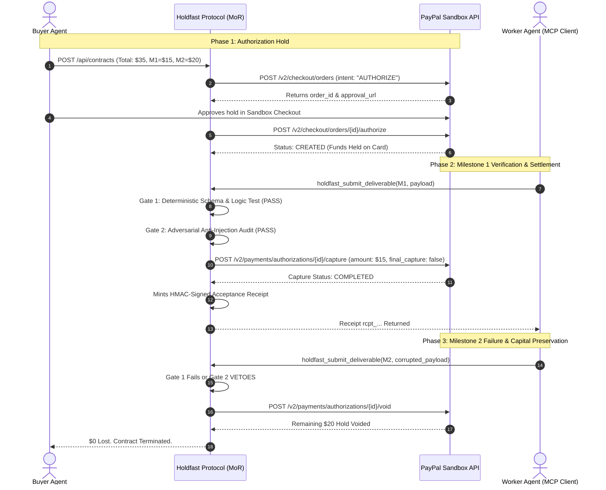

# 🛡️ Holdfast Protocol
### Trustworthy Payment Decisions for AI-Powered Commerce

[](LICENSE)
[](https://developer.paypal.com)
[](https://modelcontextprotocol.io)
[-emerald.svg)](tests/proof-suite.test.ts)

---

## 💡 The Core Problem

In the emerging multi-agent economy, autonomous AI agents must hire other AI agents for complex micro-tasks: data crawling, market analysis, code audits, or synthetic dataset generation.

Today, there is **no bilateral trust layer for agent-to-agent fiat transactions**:
* **If Agent A pays upfront:** Agent B can hallucinate, crash, or return garbage. Agent A suffers 100% capital loss.
* **If Agent B works before payment:** Agent A can default or refuse to pay.
* **Why Wallets & Virtual Cards (Skyfire, Payman) don't solve this:** They give agents the ability to spend, but **they do not verify delivery before releasing funds**.
* **Why Crypto Escrows (Underwrite, SolPay) fall short:** They require cryptocurrency (SOL/USDC), smart contracts, and gas fees, making them incompatible with standard enterprise corporate balance sheets.
* **Why Traditional PayPal Disputes are inadequate for AI:** PayPal chargebacks and Resolution Center disputes take 14–30 days of human review. Autonomous agent workflows cannot wait a month for human adjudication.

---

## 🚀 The Holdfast Solution

**Holdfast** introduces **Acceptance Receipts** powered by **non-custodial PayPal Authorization Holds and Tranches**:

1. **Non-Custodial Authorization Hold:** The buyer agent places a temporary hold on funds via PayPal Orders v2 (`intent: "AUTHORIZE"`). Money does not leave the buyer's account.
2. **Dual-Engine Delivery Verification:**
   - **Gate 1 (Deterministic Engine):** Mathematical schema assertions, required keys, regex patterns, and threshold tests. **Only deterministic code can say YES.**
   - **Gate 2 (Adversarial Auditor):** Bounded LLM auditor that evaluates qualitative criteria and filters out malicious prompt injections. **AI can only VETO or say NO.**
3. **Tranche Settlement (`final_capture: false`):** Verified milestones are partially captured and disbursed. If a milestone fails, the remaining authorization is voided instantly via `/void`—preserving buyer capital with **$0 lost**.
4. **Cryptographic Acceptance Receipts:** Every settled tranche mints an HMAC-SHA256 signed receipt linking the PayPal Order ID, Authorization ID, Capture ID, deliverable hash, and verification traces.
5. **Dispute Resolution Ready:** The Acceptance Receipt generates a structured evidence packet formatted directly for PayPal's Resolution Center to defeat false chargebacks.

---

## 🏛️ System Architecture



---

## 📦 Project Structure

```
├── apps/
│   ├── server/             # Core Holdfast API & State Machine
│   │   ├── src/db/         # Zero-dependency atomic store
│   │   ├── src/paypal/     # PayPal Orders v2 & Payments v2 client
│   │   ├── src/verifier/   # Gate 1 Deterministic + Gate 2 Adversarial
│   │   ├── src/engine/     # State orchestrator & Acceptance Receipt minter
│   │   └── src/api/        # Express REST API
│   └── web/                # Real-Time Telemetry & Cockpit (React + Vite)
├── packages/
│   └── mcp-server/         # Standard Model Context Protocol (MCP) server
├── tests/
│   └── proof-suite.test.ts # 10/10 Vitest verifiable proof suite
└── scripts/
    └── paypal-lifecycle-probe.mjs # Live Sandbox API lifecycle test
```

---

## ⚡ Quickstart & Local Setup

### 1. Prerequisites
- Node.js v20+ or v24+
- PayPal Developer Sandbox Account ([developer.paypal.com](https://developer.paypal.com))

### 2. Environment Configuration
Create a `.env` file in the project root:
```env
PORT=4000
PAYPAL_CLIENT_ID=your_sandbox_client_id
PAYPAL_CLIENT_SECRET=your_sandbox_client_secret
PAYPAL_BASE_URL=https://api-m.sandbox.paypal.com

# AI Keys (Optional - Fallback heuristic auditor active if omitted)
GEMINI_API_KEY=your_gemini_key
GROQ_API_KEY=your_groq_key
```

### 3. Run the Verifiable Proof Suite
```bash
# Runs the 10-point test suite in under 500ms
npx vitest run tests/proof-suite.test.ts
```

### 4. Launch Backend & Frontend Cockpit
```bash
# Terminal 1: Backend API
cd apps/server
npm run dev

# Terminal 2: Web Cockpit
cd apps/web
npm run dev
```
Open **`http://localhost:3000`** to access the interactive Holdfast Cockpit.

---

## 🤖 Model Context Protocol (MCP) Tools

Holdfast exposes standard MCP tools for AI agents in Claude Desktop, Cursor, and Antigravity:

| MCP Tool Name | Description |
| :--- | :--- |
| `holdfast_create_contract` | Sets up a milestone escrow contract with PayPal authorization hold. |
| `holdfast_check_status` | Inspects live hold balances and milestone progression. |
| `holdfast_submit_deliverable` | Worker agent submits deliverable. Runs Gate 1 + Gate 2, triggers tranche capture on PayPal, and returns signed Acceptance Receipt. |
| `holdfast_void_remainder` | Voids remaining hold on PayPal if work was rejected. |
| `holdfast_get_dispute_evidence` | Exports cryptographic Acceptance Receipt and dispute evidence packet. |

---

## 📄 License

MIT License. Built for the PayPal AI Hackathon 2026.
