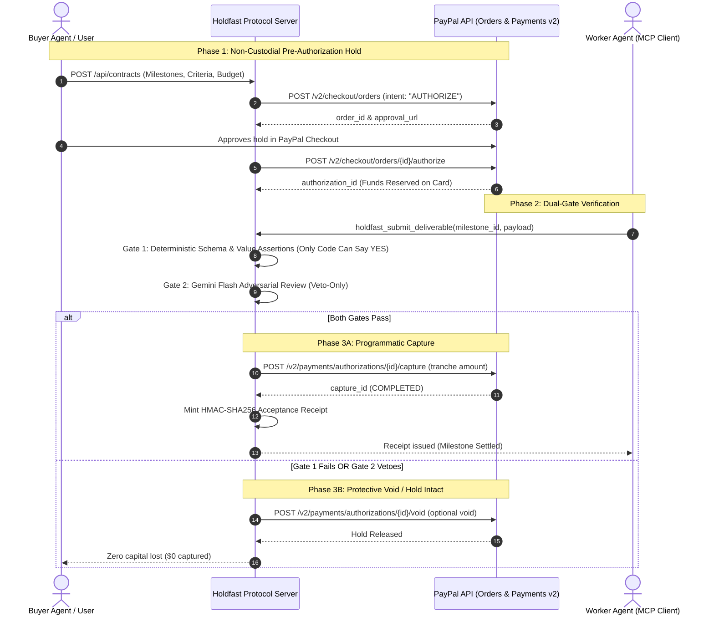

# Holdfast Protocol
> **Trust infrastructure for AI-powered commerce.**  
> *Payments for AI agents, with verifiable safeguards.*

[](LICENSE)
[](https://developer.paypal.com)
[](https://modelcontextprotocol.io)
[](tests/)

---

## 1. Product Overview

In the emerging autonomous economy, artificial intelligence agents are discovering services, negotiating digital work, and initiating transactions. However, granting autonomous agents direct, unconstrained access to payment cards or financial APIs creates an existential security challenge:

1. **The Bilateral Trust Deficit:**
   - **If the buyer pays upfront:** The worker agent may hallucinate, crash, return malformed schemas, or inject malicious payloads. The buyer absorbs total capital loss.
   - **If the worker delivers upfront:** The hiring agent may terminate, exhaust its balance, or refuse authorization. The worker absorbs uncompensated compute and labor costs.
2. **The LLM Authority Dilemma:**
   - Standalone language models cannot be the sole authority for moving money. Probabilistic models are inherently susceptible to prompt injection, instruction hijacking, and unpredictable outputs.

**Holdfast Protocol** establishes a trust layer for agentic commerce by cleanly separating **AI proposals** from **deterministic payment enforcement**:
- **Proposals vs Execution:** AI agents generate deliverables and propose transaction parameters, but possess zero financial release authority.
- **Rule-Based Enforcement:** Payments move only when deterministic code validates schemas, required fields, and mathematical value bounds.
- **Non-Custodial Protection:** Funds are secured using PayPal authorization holds, ensuring solvency without moving funds until deliverables are independently verified.

---

## 2. Problem & Proposed Solution

```
┌─────────────────┐       ┌────────────────────────┐       ┌─────────────────┐
│   Buyer Agent   │       │   Holdfast Protocol    │       │  Worker Agent   │
│ (Hiring Client) │       │   (Trust & Gateway)    │       │  (MCP Client)   │
└────────┬────────┘       └───────────┬────────────┘       └────────┬────────┘
         │ 1. Propose Contract        │                             │
         ├───────────────────────────>│                             │
         │                            │ 2. Request Deliverable      │
         │                            ├────────────────────────────>│
         │ 3. Pre-Auth Hold on PayPal │                             │
         │ (intent: "AUTHORIZE")      │ 4. Submit Deliverable       │
         │<───────────────────────────┤<────────────────────────────┤
         │                            │                             │
         │                    [Gate 1: Invariants]                  │
         │                    [Gate 2: AI Veto]                     │
         │                            │                             │
         │                            │ 5. Verified Capture         │
         │                            ├────────────────────────────>│
         │                            │ (Mint HMAC-SHA256 Receipt)  │
```

Holdfast eliminates bilateral counterparty risk through a **four-stage guided lifecycle**:
1. **Create Payment:** Pre-authorization intent is registered with clear milestone deliverables and financial ceilings.
2. **Approve with PayPal:** The buyer authorizes an authorization hold via PayPal Orders API v2 (`intent: "AUTHORIZE"`), locking funds for up to 29 days without immediate settlement.
3. **Verify Evidence:** Autonomous deliverables pass through Gate 1 (deterministic schema validation and mathematical bounds) and Gate 2 (adversarial AI security audit).
4. **Capture Payment:** Upon dual-gate passage, Holdfast programmatically captures the exact tranche via PayPal Payments API v2 (`/capture`) and mints a tamper-evident HMAC-SHA256 acceptance receipt.

---

## 3. Key Features

- **Deterministic Invariant Engine (Gate 1):** Code-level validation verifying JSON schemas, required domain keys, minimum item counts, and positive numerical bounds. Only deterministic code can authorize payment release.
- **Adversarial AI Risk Auditing (Gate 2):** Powered by Google Gemini (`gemini-2.5-flash`) with fallback to Groq (`qwen/qwen3.8-27b`) and local heuristic token guards. Operates strictly under the **Veto-Only Principle**—the model inspects payloads for prompt injection or system override attempts and can veto a transaction, but can never approve release.
- **PayPal Orders API v2 Integration:** Creates non-custodial authorization holds (`intent: "AUTHORIZE"`) locking buyer funds on payment cards without immediate settlement.
- **PayPal Payments API v2 Integration:** Incrementally captures verified milestone tranches (`/v2/payments/authorizations/{id}/capture`) with unique idempotency keys (`PayPal-Request-Id`).
- **Authorization Hold Voiding:** Instantly terminates uncaptured holds via `/v2/payments/authorizations/{id}/void` if work fails verification or contracts are canceled (100% refundable).
- **Cryptographic Acceptance Receipts:** Mints tamper-evident HMAC-SHA256 digital signatures binding contract metadata, milestone details, deliverable hashes, and PayPal capture IDs.
- **Full-Width AG Grid Community Ledger:** Real-time financial transaction ledger featuring multi-criteria search, numeric currency sorting, state/environment filtering, and a slide-over contextual inspector drawer.
- **Lost-Response Network Reconciliation:** Fault-tolerant recovery mechanism querying PayPal authorization state during upstream connection drops to verify settled balances without risking duplicate captures.
- **Model Context Protocol (MCP) Server:** Standard stdio transport server exposing 5 tools for programmatic agent integration (`holdfast_create_contract`, `holdfast_check_status`, `holdfast_submit_deliverable`, `holdfast_void_remainder`, `holdfast_get_dispute_evidence`).

---

## 4. Architecture



### Component Structure
1. **Frontend Cockpit (`apps/web`):** Built with React 19, TypeScript, and AG Grid Community. Features the horizontal financial status strip, Payment Decision panel, 4-stage workflow stepper, and on-demand slide-over inspector drawer.
2. **Backend Engine (`apps/server`):** Built with Express and TypeScript. Manages atomic state persistence (`data/holdfast-store.json`), PayPal Orders/Payments v2 orchestration, dual-gate verification, and HMAC receipt minting.
3. **MCP Server (`packages/mcp-server`):** Implements the Model Context Protocol stdio transport for direct Claude Desktop, Cursor, and autonomous agent tool use.

---

## 5. Technology Stack

- **Languages & Runtimes:** TypeScript 5.7+, Node.js 20+ (ES Modules, npm workspaces).
- **Backend API:** Express 4.21.
- **Frontend Framework:** React 19, Vite 6.
- **Fintech Ledger:** AG Grid Community (Quartz Light Theme with custom enterprise styling).
- **Styling:** Custom Fintech Design System (Light neutral canvas `#f8fafc`, pure white surfaces `#ffffff`, dark high-contrast typography `#0f172a`, restrained deep-blue accent `#0284c7`).
- **AI Security Evaluators:** Google Generative AI (`gemini-2.5-flash`), Groq LPU (`qwen/qwen3.8-27b`), and local regex token guards.
- **Payment Rails:** PayPal Developer Platform (Orders API v2 and Payments API v2).
- **Agent Standard:** Model Context Protocol SDK (`@modelcontextprotocol/sdk`).
- **Test Framework:** Vitest 3.x / 5.x.
- **Video Production:** FFmpeg 6.1, Windows Speech Synthesis.

---

## 6. Demonstration Video

The official 1080p demonstration video is committed in the repository:

- **Video Path:** [`demo/Holdfast-Protocol-Professional-Demo.mp4`](demo/Holdfast-Protocol-Professional-Demo.mp4) (Mirror: [`demo/Holdfast-Protocol-Demo.mp4`](demo/Holdfast-Protocol-Demo.mp4))
- **Duration:** 2 minutes 48 seconds (Strictly < 3 minutes)
- **Specifications:** 1920x1080, 16:9, H.264 High Profile, AAC 22.05 kHz audio
- **Full Production Script:** [`docs/PROFESSIONAL_DEMO_SCRIPT.md`](docs/PROFESSIONAL_DEMO_SCRIPT.md)
- **Technical Production Notes:** [`docs/VIDEO_PRODUCTION_NOTES.md`](docs/VIDEO_PRODUCTION_NOTES.md)

---

## 7. Quick-Start Guide

### Prerequisites
- **Node.js:** v20.12.0 or higher
- **npm:** v10.0.0 or higher
- **Git**

### Installation

#### Windows (PowerShell)
```powershell
git clone https://github.com/faizkhatri196/PayPal-Hackthon.git
cd PayPal-Hackthon
npm install
Copy-Item .env.example .env
npm run dev
```

#### macOS / Linux (Bash)
```bash
git clone https://github.com/faizkhatri196/PayPal-Hackthon.git
cd PayPal-Hackthon
npm install
cp .env.example .env
npm run dev
```

The application will be live at:
- **Frontend Dashboard:** `http://localhost:3000`
- **Backend REST API:** `http://localhost:4000`
- **Status & Health Probe:** `http://localhost:4000/api/status`

> **Note on Zero-Config Demo Mode:** Holdfast operates out-of-the-box in **Demo — Simulated** mode with **zero API keys required**. All three test scenarios, AG Grid interactions, and verification engines run locally without configuring external credentials.

---

## 8. Environment Configuration

Copy `.env.example` to `.env`. All keys use safe placeholders:

```ini
# Server Network Configuration
PORT=4000
NODE_ENV=development
APP_URL=http://localhost:4000
CORS_ORIGIN=*
VITE_API_URL=http://localhost:4000

# PayPal Sandbox Credentials (Required ONLY for Live PayPal Sandbox mode)
PAYPAL_CLIENT_ID=your_paypal_sandbox_client_id_here
PAYPAL_CLIENT_SECRET=your_paypal_sandbox_client_secret_here
PAYPAL_BASE_URL=https://api-m.sandbox.paypal.com

# AI Provider Configuration (Optional: system uses local heuristic fallback if omitted)
AI_PROVIDER=gemini
GEMINI_API_KEY=your_gemini_api_key_here
GROQ_API_KEY=your_groq_api_key_here
OPENAI_API_KEY=your_openai_api_key_here

# Cryptographic Receipt Secret
RECEIPT_SECRET=holdfast_receipt_hmac_secret_2026_change_in_production
```

---

## 9. PayPal Sandbox Setup & Live Verification

To test live PayPal Sandbox holds and captures:

1. Log into the [PayPal Developer Dashboard](https://developer.paypal.com).
2. Navigate to **Apps & Credentials** and select your Sandbox app.
3. Copy the **Client ID** and **Secret** into your `.env` file.
4. Restart the server (`npm run dev`).
5. In the top header of `http://localhost:3000`, observe the connection indicator:
   - When connected, it displays `PayPal Sandbox: Connected` with live OAuth latency (e.g. `1286ms`).
   - Click the indicator to view the live OAuth handshake probe.

### The 5-Stage Live PayPal Lifecycle
1. **OAuth 2.0 Token Generation:** Handshake against `https://api-m.sandbox.paypal.com/v1/oauth2/token` (Automated).
2. **Order Creation:** `POST /v2/checkout/orders` with `intent: "AUTHORIZE"` (Automated).
3. **Interactive Buyer Approval:** The buyer visits `https://www.sandbox.paypal.com/checkoutnow?token=...` and signs in with their personal Sandbox buyer account to grant approval (Human Action).
4. **Authorization Hold:** `POST /v2/checkout/orders/{id}/authorize` locks card funds for 29 days (Automated upon approval).
5. **Partial Tranche Capture:** `POST /v2/payments/authorizations/{id}/capture` captures the verified milestone amount upon dual-gate verification (Dual-gate enforced).

---

## 10. AI Provider Configuration & Fallback

- **Google Gemini:** Set `GEMINI_API_KEY` to enable `gemini-2.5-flash` adversarial evaluation.
- **Groq:** Set `GROQ_API_KEY` to enable `qwen/qwen3.8-27b` worker simulation.
- **Local Fallback:** If neither API key is provided, Holdfast automatically routes verification through built-in regex heuristic token guards (`apps/server/src/verifier/adversarial.ts`). The application will never crash or fail due to missing AI credentials.

---

## 11. Automated Testing & Workspace Builds

### Running Automated Tests
```bash
npx vitest run tests/
```

**Verified Test Suite Results (44/44 Passing):**
- `tests/money-invariants.test.ts` (8 tests): Integer minor-units math, ceiling enforcement, and non-negative bounds.
- `tests/proof-suite.test.ts` (10 tests): Multi-gate verification, prompt-injection vetoes, and HMAC integrity.
- `tests/hash-determinism.test.ts` (3 tests): Canonical JSON hashing and tamper detection.
- `tests/rebuild-spec.test.ts` (6 tests): State orchestrator lifecycle and audit logging.
- `tests/release-refinement.test.ts` (9 tests): Connection failure reporting, demo isolation, and state machine transitions.
- `tests/paypal-sandbox-journey.test.ts` (8 tests): PayPal Sandbox order creation, duplicate capture prevention, and adversarial veto enforcement.

### Compiling Workspace Production Builds
```bash
npm run build --workspaces
```
Builds `@holdfast/server`, `@holdfast/web` (Vite production bundle), and `@holdfast/mcp-server` with **exit code 0**.

---

## 12. Model Context Protocol (MCP) Integration

Holdfast exposes a full MCP server (`packages/mcp-server`) communicating over standard stdio transport:

```json
{
  "mcpServers": {
    "holdfast": {
      "command": "node",
      "args": ["./packages/mcp-server/dist/index.js"]
    }
  }
}
```

### Available MCP Tools
- `holdfast_create_contract`: Initializes an agreement with milestones and budget ceiling.
- `holdfast_check_status`: Queries current authorization, milestone, and payment state.
- `holdfast_submit_deliverable`: Submits worker output for dual-gate verification.
- `holdfast_void_remainder`: Releases uncaptured authorization hold back to the buyer.
- `holdfast_get_dispute_evidence`: Fetches the HMAC-signed dispute resolution packet.

---

## 13. Security Model & Trust Boundaries

| Layer | Responsibility | Authority | Failure Outcome |
| :--- | :--- | :--- | :--- |
| **Gate 1 (Deterministic)** | Schema validation, required domain keys, mathematical ceilings | **Only code can authorize release** | **Halt execution ($0 moved)** |
| **Gate 2 (AI Security)** | Prompt-injection screening, system instruction overrides | **Veto-Only** (Can block, never release) | **Issue irrevocable VETO ($0 moved)** |
| **PayPal API (Rails)** | Authorization holds (`intent: AUTHORIZE`), tranche captures | Card network settlement | Reconcile or void hold |
| **HMAC Signatures** | Cryptographic proof of deliverable hash & capture IDs | Proves state integrity relative to secret | Verifier flags tamper |

---

## 14. Demo vs. Live Sandbox Behavior

| Dimension | Demo — Simulated Mode | Live PayPal Sandbox Mode |
| :--- | :--- | :--- |
| **Network Calls** | **ZERO outbound calls to PayPal** | Communicates with `api-m.sandbox.paypal.com` |
| **Funds Movement** | **$0.00 (Simulated)** | Real sandbox card authorization & capture |
| **Identifiers** | Prefixed `tx_demo_`, `DEMO_ORD_` | Authentic PayPal IDs (`AUTH-`, `CAPTURE-`) |
| **UI Badge** | `DEMO — SIMULATED (No funds moved)` | `Live PayPal Sandbox` |

---

## 15. Known Limitations & Disclosures

- **Not Legal Escrow:** Programmatic pre-authorization holds operate under payment card network rules and do not constitute legal third-party custodial escrow trust accounts.
- **Worker Payout SDK:** Tranche captures settle into the platform's merchant PayPal balance. Distributing payouts to worker external bank accounts requires secondary integration with the PayPal Payouts SDK.
- **29-Day Hold Window:** Under card network rules, PayPal authorization holds expire after 29 days.

---

## 16. Product Demonstration Video

The repository includes a verified, 1080p full product presentation with timed narration and live browser interactions:
- **Demonstration Video:** [`demo/Holdfast-Protocol-Professional-Demo.mp4`](demo/Holdfast-Protocol-Professional-Demo.mp4) (Duration: `00:02:46`, 1920x1080 30 FPS, H.264 / AAC)
- **Standard Mirror:** [`demo/Holdfast-Protocol-Demo.mp4`](demo/Holdfast-Protocol-Demo.mp4)
- **Timed Narration Script:** [`docs/PROFESSIONAL_DEMO_SCRIPT.md`](docs/PROFESSIONAL_DEMO_SCRIPT.md)
- **Production & Engineering Notes:** [`docs/VIDEO_PRODUCTION_NOTES.md`](docs/VIDEO_PRODUCTION_NOTES.md)

---

## 17. License

This project is licensed under the **MIT License** — see the [LICENSE](LICENSE) file for details.
