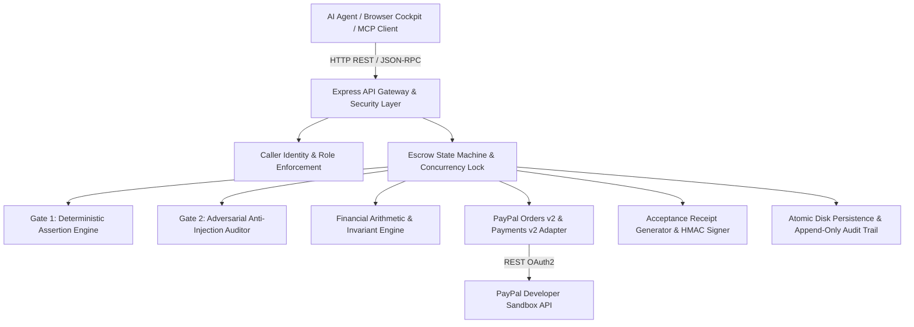

# 🏛️ Holdfast Protocol — Architecture Specification

## 1. System Overview & Component Responsibilities

Holdfast Protocol is a modular monolith architected for high reliability, verifiable evidence, and conservative financial operations.



### Component Inventory

1. **`apps/server` (Core Engine):**
   - **`api/routes.ts`:** REST endpoints handling contract lifecycle, deliverable submission, hold verification, receipts, and reconciliation.
   - **`engine/orchestrator.ts`:** Central state machine enforcing strict lifecycle transitions, in-flight mutexes, and payment execution policies.
   - **`utils/money.ts`:** Dedicated integer minor-unit (cents) arithmetic engine ensuring zero floating-point errors.
   - **`verifier/deterministic.ts`:** Gate 1 machine-checkable schema validation, regex rules, numerical bounds, and hash calculations. (Only code can say YES).
   - **`verifier/adversarial.ts`:** Gate 2 bounded LLM auditor enforcing the Veto-Only principle with anti-prompt-injection shields. (AI can only say NO).
   - **`engine/receipt.ts`:** Tamper-evident Acceptance Receipt minter producing HMAC-SHA256 signatures and structured PayPal Dispute Evidence Packets.
   - **`paypal/client.ts`:** Robust PayPal API client implementing Orders v2 (`intent: AUTHORIZE`), Payments v2 (tranches, voids), idempotency (`PayPal-Request-Id`), and reconciliation.
   - **`db/store.ts`:** Atomic disk-persisted data store with write-ahead audit logs and crash resilience.

2. **`apps/web` (Interactive Fintech Cockpit):**
   - Live telemetry dashboard communicating contract states, held balances, settled tranches, and verification traces.
   - Interactive Scenario Runner allowing hackathon judges to verify clean captures, prompt-injection vetoes, voiding, and lost-response recovery in real time.

3. **`packages/mcp-server` (Model Context Protocol Integration):**
   - Standard Stdio JSON-RPC 2.0 MCP server exposing typed tools (`holdfast_create_contract`, `holdfast_check_status`, `holdfast_submit_deliverable`, etc.) for external AI agents in Claude Desktop, Cursor, or Antigravity.

---

## 2. Security Boundaries & Invariants

| Boundary | Enforcement Mechanism | Failure Policy |
| :--- | :--- | :--- |
| **Client $\to$ Server** | Explicit caller identity (`x-agent-id`, `x-agent-role`), payload schema validation via Zod, rate limiting, and 2MB body limit. | Fail Closed (`HTTP 400/401/403`). |
| **Gate 1 Verification** | Strict JSON schema, required keys, strictly positive numbers, count thresholds, and SHA-256 hash matching. | Fail Closed. If Gate 1 fails, Gate 2 is never called and funds remain held. |
| **Gate 2 AI Audit** | Untrusted worker content isolated in text envelopes; strict system instructions; temperature 0.0. | Veto-Only: AI can only say NO or flag anomalies. It can NEVER unilaterally release funds. |
| **Financial Execution** | Cents integer arithmetic; validation that requested capture $\le$ remaining uncaptured authorization; in-flight contract mutex. | Invariant Violation Exception. Provider is never called if invariant fails. |
| **PayPal API Calls** | Guaranteed `PayPal-Request-Id` UUID v4 header; timeout handling; status inspection (`COMPLETED` vs `PENDING`). | If response drops, transition to `REQUIRES_RECONCILIATION`. Never blind retry. |
| **Receipt Integrity** | HMAC-SHA256 digital signature over canonical string. | Signature mismatch indicates tampering; receipt rejected. |

---

## 3. Explicit State Machine Transitions

```
[DRAFT]
   │
   ▼
[AWAITING_BUYER_APPROVAL] ──(Buyer rejects or cancels)──► [CANCELLED]
   │
   ▼ (Buyer approves on Sandbox & /authorize called)
[ESCROW_HELD]
   │
   ├──(Worker delivers milestone)──► [VERIFYING]
   │                                   │
   │   ┌───(Gate 1 or Gate 2 fails)────┘
   │   ▼
   │ [REJECTED] ──(Retry or SLA timeout)──► [VOIDED] (Remaining hold released)
   │
   │   ┌───(Both gates pass & capture succeeded)
   │   ▼
   ├──► [PARTIALLY_SETTLED] (If more milestones remain active)
   │        │
   │        ▼ (Final milestone settled)
   └──► [COMPLETED]
```

---

## 4. Threat Model & Security Matrix

| Threat | Impact | Existing Control in Holdfast |
| :--- | :--- | :--- |
| **Prompt Injection in Deliverable** | High | **Gate 1 Pre-Check:** Mathematical schema checks must pass first. **Gate 2 Veto-Only:** AI can only reject; it cannot release funds. |
| **Duplicate Capture on Dropped Response** | Critical | **Idempotency Headers:** `PayPal-Request-Id` UUID v4 header passed on every capture. **Reconcile:** Live authorization query. |
| **Concurrent Mutation Race Conditions** | High | **In-Flight Mutex:** State orchestrator locks contract during active mutations. |
| **Over-Capture Authorization Exceedance** | Critical | **Integer Cents Boundary Check:** `validateCaptureBounds` verifies remaining hold before calling PayPal. |
| **Acceptance Receipt Tampering** | Medium | **HMAC-SHA256 Digital Signature:** Mints digital signature over canonical string. Tampering invalidates signature. |
| **API Secret Exposure** | Critical | **Backend Isolation:** PayPal and AI credentials stay on server. 0 secrets in browser or Git. |

---

## 5. Central 5-Stage Payment Workflow & AI Allocation

Holdfast simplifies multi-stage agentic commerce into five sequential, inspectable stages:

```
[ Stage 1: AI Agent Completes Work ]
  Engine: Groq LPU (qwen/qwen3.8-27b)
  Role: Autonomous Worker Proposer (Zero Financial Authority)
      │
      ▼
[ Stage 2: Holdfast Verifies Result ]
  Engine: Gate 1 Deterministic Engine
  Role: Schema, Key, and Arithmetic Bounds Verifier (Sole Authority to Release Funds)
      │
      ▼
[ Stage 3: Payment Approved or Blocked ]
  Engine: Gate 2 Gemini 2.5 Flash / Security Filter
  Role: Adversarial Auditor (Veto-Only: Detects Prompt Injections & Anomalies)
      │
      ▼
[ Stage 4: PayPal Processes Payment ]
  Engine: PayPal Orders v2 & Payments v2 Sandbox
  Role: Idempotent Non-Custodial Pre-Auth Hold & Tranche Capture
      │
      ▼
[ Stage 5: Proof is Recorded ]
  Engine: Cryptographic Receipt Engine
  Role: HMAC-SHA256 Signed Evidence Packet for PayPal Resolution Center
```


